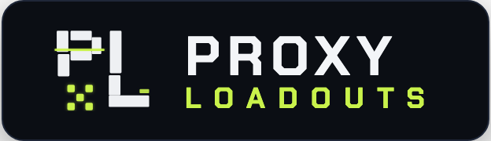

<div align="center">

<a href="https://proxyloadouts.com">
  
</a>

**Equipment Preset Manager & Squad Planner for *Zenless Zone Zero***

[](.github/workflows/ci.yml)
[](frontend/README.md)
[](backend/README.md)
[](contracts/openapi.yaml)
[](LICENSE)

[**Frontend & UI/UX Showcase**](frontend/README.md) · [**Backend Architecture**](backend/README.md) · [**OpenAPI 3.1 Spec**](contracts/openapi.yaml)

</div>

---

## Why ProxyLoadouts Exists

*Zenless Zone Zero* still lacks built-in **equipment presets (loadouts)** for Drive Discs and W-Engines, despite long-standing player requests.

In endgame modes like **Shiyu Defense** and **Deadly Assault**, enemy lineups, attribute resistances, and stage buffs rotate constantly. Adapting to a specific boss or stage often requires assembling different 3-agent squads—and not every agent has a single universal build:

- Depending on teammates or boss mechanics, an agent may need a **different W-Engine**, a **different 4pc/2pc Drive Disc set**, or a **different main stat on Slots 4, 5, or 6** (for example, swapping Slot 5 between *PEN Ratio* and *Attribute DMG%*, or Slot 6 between *Anomaly Mastery* and *ATK%*).
- Over time, players accumulate hundreds of Drive Discs. Remembering which exact 6 discs belong to which setup across different teams becomes nearly impossible.
- **Saving builds with in-game screenshots is tedious**: the in-game UI only shows a Drive Disc's substats when you click on that specific slot. You cannot view all 6 discs at once, so saving a single build takes **6–7 separate screenshots**, with no convenient way to organize which screenshots belong to which squad or boss.

---

## How ProxyLoadouts Solves This

ProxyLoadouts is a web service that gives you an external loadout library and squad planner powered by your in-game showcase:

1. **One-Screen Build Capture (`Showcase`)**: Place your agents on your in-game showcase and scan your UID (powered by EnkaNetwork). Instead of taking 6 separate screenshots, you see the agent's W-Engine, total stats, and **all 6 Drive Discs with their substat rolls** on a single screen.
2. **Multiple Presets per Agent (`Roster`)**: Save up to **5 named builds per agent** with custom notes—so you can keep dedicated presets for different teams, bosses, or combat buffs.
3. **Squad Planner with Conflict Check (`Squads`)**: Combine saved agent presets into 3-agent squads with notes (e.g., which boss the squad targets or which disc to swap). When picking builds for a squad, ProxyLoadouts automatically warns you if two agents share the exact same W-Engine or Drive Disc.

> While you still equip Drive Discs manually in-game, you always know **exactly which W-Engine and which 6 Drive Discs** to put on each agent for any squad or boss.

---

## Documentation Structure

Detailed technical and visual documentation is split by subsystem:

| Document | What It Covers |
| :--- | :--- |
| **[Frontend & UI/UX Guide (`frontend/README.md`)](frontend/README.md)** | **Visual walkthrough with screenshots**, UI/UX design decisions (solving the 6-screenshot problem, substat roll highlighting, conflict picker UX), design tokens, and React 19 state architecture. |
| **[Backend Architecture (`backend/README.md`)](backend/README.md)** | **Go 1.26 Hexagonal architecture**, pure-Go SQLite WAL storage, EnkaNetwork `singleflight` + LRU caching, AES-256-GCM stateless sessions, security middleware, and single-binary deployment. |
| **[OpenAPI 3.1 Contract (`contracts/openapi.yaml`)](contracts/openapi.yaml)** | Formal REST API specification serving as the single source of truth between the Go backend and TypeScript frontend. |

---

## Tech Stack at a Glance

- **Frontend**: React 19, TypeScript 6.0, Vite 8, Tailwind CSS v4, Radix UI Primitives, TanStack Query v5, Zustand v5, i18next (`EN` / `RU`).
- **Backend**: Go 1.26 (`CGO_ENABLED=0`), Chi v5 router, Pure-Go SQLite (`modernc.org/sqlite` in WAL mode), EnkaNetwork & [`fairy`](https://github.com/kirinyoku/fairy) ZZZ catalog SDK, Discord OAuth2.
- **Deployment**: Compiles into a **single self-contained Go binary** (`//go:embed`) consuming **~35 MB of RAM**, packaged via a multi-stage non-root Docker image alongside Dozzle for live container logs.

---

## Development & Production Deployment

### 1. Local Development (HMR)

Requires **Go 1.26+** and **Node.js 22+**.

```bash
cp backend/.env.example backend/.env

# Terminal 1 — Go API server (:8080)
make dev-backend

# Terminal 2 — Vite dev server with HMR (:5173)
make dev-frontend
```

> **Note on Discord OAuth2 in Dev Mode**: In `ENV=development`, the backend starts without `DISCORD_CLIENT_ID` / `DISCORD_CLIENT_SECRET` so you can immediately work on public pages and UID showcase scanning (`/api/v1/showcase/{uid}`). To test authenticated flows (`Roster`, `Squads`, `Settings`) in the browser, add your Discord OAuth2 dev credentials to `backend/.env`.

### 2. Production Deployment (Docker Compose)

For deploying on a server, configure the required production variables (`SESSION_SECRET`, `DISCORD_CLIENT_ID`, `DISCORD_CLIENT_SECRET`, `FRONTEND_URL`) in `deploy/.env`:

```bash
cp deploy/.env.example deploy/.env
# Fill in required production secrets in deploy/.env
make docker-up

# App UI & API:     http://localhost:8080
# Dozzle Live Logs: http://localhost:8888
```

You can also compile the production single binary directly (`frontend/dist` embedded into `backend/bin/server` via `//go:embed`) with `make build`.

### Common `Makefile` Commands

| Command | Description |
| :--- | :--- |
| `make dev-backend` | Start Go backend API server (`:8080`) |
| `make dev-frontend` | Start Vite frontend dev server with HMR (`:5173`) |
| `make codegen` | Generate TypeScript API types (`openapi-typescript`) & game constants |
| `make lint` | Run all linters (`redocly`, `golangci-lint`, `oxlint`) |
| `make test` | Run all tests (Go `-race` suite + Frontend Vitest suite) |
| `make build` | Build standalone single binary with embedded frontend (`backend/bin/server`) |
| `make check` | Full CI quality gate (`lint` + `test` + `build`) |
| `make docker-up` | Build and start production Docker stack (App + Dozzle) |
| `make docker-down` | Stop and remove Docker Compose containers |

---

## Repository Structure

```text
proxyloadouts/
├── contracts/
│   └── openapi.yaml        # OpenAPI 3.1 API specification (SSOT)
├── backend/                # Go 1.26 backend service (see backend/README.md)
│   ├── cmd/                # Server entrypoint & game catalog codegen CLI
│   ├── internal/           # Domain, conflict engine, use cases, adapters
│   └── migrations/         # Embedded SQLite schema migrations
├── frontend/               # React 19 SPA client (see frontend/README.md)
│   ├── src/                # UI components, pages, hooks, stores, i18n
│   └── e2e/                # Playwright E2E tests
├── deploy/                 # Production Docker Compose stack & env template
├── docs/images/            # Interface screenshots referenced in frontend/README.md
├── Dockerfile              # Multi-stage static binary build
└── Makefile                # Monorepo orchestration commands
```

---

## License

Licensed under the [GNU Affero General Public License v3.0 (AGPLv3)](LICENSE).

> **Disclaimer**: *ProxyLoadouts is an independent fan-made project and is not affiliated with or endorsed by HoYoverse / COGNOSPHERE PTE. LTD. All Zenless Zone Zero game assets and trademarks belong to their respective owners.*
