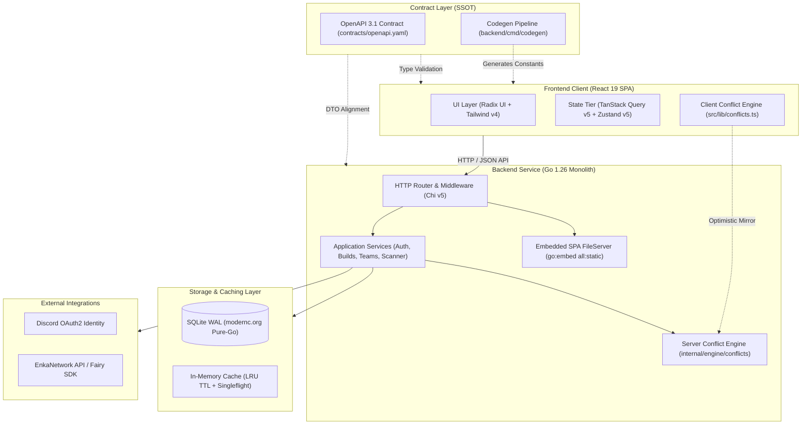

# ProxyLoadouts (PXL)

[](.github/workflows/ci.yml)
[](backend/README.md)
[](frontend/README.md)
[](frontend/tsconfig.json)
[](contracts/openapi.yaml)
[-003B57?logo=sqlite)](backend/README.md)
[](LICENSE)

> A production-grade, fullstack loadout and combat squad manager for *Zenless Zone Zero* (ZZZ) with automated equipment conflict validation, public showcase synchronization, and single-binary deployment.

---

## Table of Contents

1. [Project Overview & Problem Statement](#project-overview--problem-statement)
2. [Fullstack System Architecture](#fullstack-system-architecture)
3. [Key Engineering Highlights](#key-engineering-highlights)
4. [Monorepo Structure](#monorepo-structure)
5. [Operational Lifecycle & Execution Modes](#operational-lifecycle--execution-modes)
6. [Quality Assurance & Automated Verification](#quality-assurance--automated-verification)
7. [Subsystem Documentation](#subsystem-documentation)
8. [License](#license)

---

## Project Overview & Problem Statement

In *Zenless Zone Zero* (ZZZ), players frequently reconfigure equipment (W-Engines and 6 Drive Disc slots) across multiple characters to tackle divergent endgame combat challenges (Shiyu Defense, Deadly Assault). Managing these builds manually creates severe friction:

- **Equipment Overlap**: Swapping discs between characters often leads to accidental duplicate assignments or broken team compositions.
- **Roster & Gear Isolation**: Players lack an offline or quick-access interface to prototype multi-agent squads without launching the full game client.

**ProxyLoadouts** solves this by providing:
1. **Showcase Profile Sync**: Fetching active showcase agents, W-Engines, and Drive Discs directly from the game network via [EnkaNetwork](https://enka.network/) and the [Fairy SDK](https://github.com/kirinyoku/fairy).
2. **Build Library**: Persisting multiple alternate equipment presets per agent (e.g. Anomaly DPS, Crit DPS, Support).
3. **Automated Conflict Engine**: Algorithmic validation ensuring that no Drive Disc (slots 1–6) or W-Engine is assigned to more than one agent in an active 3-member combat squad.
4. **Single-Binary Portability**: The entire fullstack application (Go server + embedded React SPA + SQLite database) compiles into an autonomous static executable.

---

## Fullstack System Architecture

The application is structured as a modular monorepo governed by a **Contract-First (OpenAPI 3.1)** specification as the single source of truth (SSOT).



---

## Key Engineering Highlights

### 1. Contract-First Governance (OpenAPI 3.1 as SSOT)
- Every endpoint, request payload, response schema, and error representation is formally specified in [`contracts/openapi.yaml`](contracts/openapi.yaml).
- Eliminates drift between backend Go handlers and frontend TypeScript consumers.
- The `backend/cmd/codegen` tool inspects the game catalog and automatically generates immutable TypeScript constants (`frontend/src/lib/game-constants.generated.ts`).

### 2. Standalone Single-Binary Deployment (`go:embed`)
- In addition to standard decoupled dev workflows, the React 19 production build is embedded directly into the Go executable via `//go:embed all:static`.
- The server serves the embedded SPA with strict browser cache policies (`Cache-Control: public, max-age=31536000, immutable` for hashed assets) and transparent History API routing fallback.
- Enables zero-configuration desktop distribution and single-container deployments.

### 3. Pure-Go SQLite in WAL Mode
- Persistence uses `modernc.org/sqlite` compiled with `CGO_ENABLED=0`, eliminating C-toolchain dependencies and enabling effortless cross-compilation.
- Configured with `PRAGMA journal_mode = WAL`, `PRAGMA busy_timeout = 5000`, and `PRAGMA foreign_keys = ON`.
- Readers execute concurrently without blocking writers; schema migrations (`backend/migrations/001_init.sql`) apply idempotently at startup within a serializable transaction.

### 4. External Dependency Resiliency & Thundering Herd Defense
- To protect upstream game APIs (EnkaNetwork) against aggressive rate limiting:
  - **Request Coalescing (`singleflight`)**: Concurrent requests for the same player UID are collapsed into a single upstream network call.
  - **Two-Tier In-Memory Caching**: Positive LRU cache (TTL-bounded profile snapshots) and negative cache (short-lived entries for 404/empty showcases).
  - **Token-Bucket Rate Limiter**: Per-IP rate limiting (`golang.org/x/time/rate`) on public showcase fetch routes.

### 5. Dual-Layer Conflict Detection Engine
- A dedicated algorithmic validator ($O(N \cdot M)$ complexity) ensures equipment uniqueness across squad members.
- Executed **optimistically on the client** ($0\text{ms}$ UI response during drag-and-drop squad assembly) and **authoritatively on the server** during database write transactions (returning HTTP 422 with structured `ConflictReport` DTOs upon violations).

### 6. Defense-in-Depth Security
- **Stateless Encrypted Sessions**: Session cookies are encrypted and authenticated with AES-256-GCM using `SESSION_SECRET`.
- **Instant Revocation without Redis**: A database `token_version` column on `users` invalidates all issued session cookies globally upon logout.
- **CSRF & Origin Isolation**: Strict comparison of `Origin` and `Referer` headers against `FRONTEND_URL`, complemented by mandatory `X-Requested-With` or `X-CSRF-Token` headers.

---

## Monorepo Structure

```
├── .github/
│   └── workflows/
│       └── ci.yml            # CI: Go race tests, golangci-lint, oxlint, E2E, standalone build
├── contracts/
│   └── openapi.yaml          # OpenAPI 3.1 single source of truth contract
├── backend/                  # Go 1.26 Core Service (Clean Architecture)
│   ├── cmd/
│   │   ├── codegen/          # CLI generating frontend game constants from Fairy SDK
│   │   └── server/           # Runtime entrypoint, signal handling, graceful shutdown
│   ├── internal/
│   │   ├── adapter/          # SQLite WAL, Chi HTTP, Discord OAuth2, Fairy SDK adapters
│   │   ├── app/              # Application services (auth, builds, scanner, teams)
│   │   ├── domain/           # Pure entities, domain invariants, repository interfaces
│   │   └── engine/conflicts/ # In-memory conflict detection engine
│   ├── migrations/           # Embedded SQL schema migrations (001_init.sql)
│   ├── Makefile              # Backend operational Makefile
│   └── README.md             # Detailed backend architectural specification
├── frontend/                 # React 19 SPA (Vite + Tailwind CSS v4)
│   ├── src/
│   │   ├── api/              # Typed fetch client, ApiError class, TanStack Query hooks
│   │   ├── components/       # Radix UI headless primitives & composite widgets
│   │   ├── lib/              # Client conflict engine, formatters, generated constants
│   │   ├── pages/            # Route views (Roster, Teams, Showcase, Settings)
│   │   └── store/            # Zustand client draft stores (teamBuilderStore)
│   ├── e2e/                  # Playwright end-to-end browser test suites
│   ├── package.json          # Dependencies & build scripts
│   └── README.md             # Detailed frontend architectural specification
├── LICENSE                   # MIT License
└── Makefile                  # Unified project orchestration commands
```

---

## Operational Lifecycle & Execution Modes

### Prerequisites

- [Go](https://go.dev/) 1.26 or higher
- [Node.js](https://nodejs.org/) 22.0.0 or higher & npm
- [golangci-lint](https://golangci-lint.run/) (v1.60+)

### 1. Configuration Setup

Copy and inspect the backend environment configuration template:

```bash
cp backend/.env.example backend/.env
```

Key environment parameters:
- `PORT`: Server port (default: `8080`).
- `DATABASE_PATH`: SQLite file path (default: `./data/proxyloadouts.db`).
- `FRONTEND_URL`: Allowed CORS origin and CSRF target (default: `http://localhost:5173`).
- `SESSION_SECRET`: 32-byte AES-GCM session key (`openssl rand -hex 32`).
- `DISCORD_CLIENT_ID` & `DISCORD_CLIENT_SECRET`: Discord OAuth credentials.

### 2. Local Development Mode

Run the backend and frontend dev servers concurrently:

```bash
# Terminal 1: Go backend API (:8080)
make run

# Terminal 2: Frontend Vite dev server (:5173 with HMR & /api/v1 proxy)
make dev-frontend
```

> In development (`ENV=development`), Discord OAuth credentials are optional. Public showcase fetching (`/api/v1/showcase/{uid}`) and the conflict validation engine work immediately out of the box.

### 3. Standalone Single-Binary Compilation

Compile the entire fullstack application into a single self-contained executable:

```bash
make build-all
```

The resulting binary (`backend/bin/server`) serves both the REST API and the embedded React SPA on a single port:

```bash
./backend/bin/server
# Open http://localhost:8080 in your browser
```

---

## Quality Assurance & Automated Verification

The repository enforces automated verification across the entire stack via the root `Makefile` and GitHub Actions CI:

```bash
# Run all quality checks across backend and frontend
make check
```

Execution breakdown:

| Suite | Scope | Toolchain | Invariants Checked |
|---|---|---|---|
| **Backend Race Tests** | `backend/` | `go test -v -race ./...` | Concurrency safety, SQLite WAL transactions, cache eviction, zero data races |
| **Backend Static Analysis** | `backend/` | `golangci-lint run ./...` | 30+ strict linters: `govet`, `staticcheck`, `gosec`, `bodyclose`, `sloglint` |
| **Frontend Static Analysis** | `frontend/` | `npm run lint` (`oxlint`) | React 19 hook invariants, JSX accessibility, TypeScript hygiene (0 warnings) |
| **Frontend Unit Tests** | `frontend/` | `npm run test` (`vitest`) | 226 unit & integration tests covering components, hooks, formatters, and conflict logic |
| **Frontend Typecheck & Build** | `frontend/` | `npm run build` (`tsc -b && vite`) | Strict TypeScript compile check, Rollup vendor code-splitting |
| **End-to-End User Journeys** | `frontend/` | `npm run test:e2e` (`playwright`) | Headless Chromium browser automation testing routing, squad assembly, and conflict alerts |

---

## Subsystem Documentation

For deep architectural dives, design rationale, and internal package taxonomy:

- [Backend Architecture & Engine Specification](backend/README.md)
- [Frontend Client & State Architecture](frontend/README.md)
- [OpenAPI 3.1 REST Contract](contracts/openapi.yaml)

---

## License

This project is licensed under the [MIT License](LICENSE).
