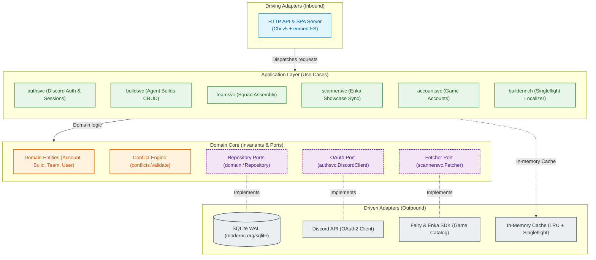

# ProxyLoadouts — Backend Core Engine

[](https://go.dev/)
[](https://en.wikipedia.org/wiki/Hexagonal_architecture_(software))
[-003B57?logo=sqlite)](https://sqlite.org/)
[](../contracts/openapi.yaml)
[](Makefile)
[-brightgreen)](.golangci.yml)

The backend service for **ProxyLoadouts (PXL)** is a high-concurrency, low-latency Go application designed to manage *Zenless Zone Zero* (ZZZ) agent builds, combat teams, showcase data synchronization, and automated equipment conflict validation.

It can operate either as a decoupled headless RESTful API server or as a **self-contained single binary** with the React 19 SPA embedded directly into the Go executable via `//go:embed`.

---

## Table of Contents

1. [Architectural Overview (Hexagonal / Ports & Adapters)](#architectural-overview)
2. [Key Engineering Decisions & Trade-Offs](#key-engineering-decisions--trade-offs)
   - [Storage Engine: Pure-Go SQLite in WAL Mode](#1-storage-engine-pure-go-sqlite-in-wal-mode)
   - [External Dependency Resilience & Thundering Herd Defense](#2-external-dependency-resilience--thundering-herd-defense)
   - [In-Memory Conflict Detection Engine](#3-in-memory-conflict-detection-engine)
   - [Stateless AES-GCM Sessions with Instant Revocation](#4-stateless-aes-gcm-sessions-with-instant-revocation)
   - [Origin & CSRF Defense Architecture](#5-origin--csrf-defense-architecture)
   - [Graceful Lifecycle & Zero-Downtime Draining](#6-graceful-lifecycle--zero-downtime-draining)
3. [Contract-First Governance & Codegen](#contract-first-governance--codegen)
4. [Database Schema & Migrations](#database-schema--migrations)
5. [Service Setup & Execution Modes](#service-setup--execution-modes)
6. [Operational Tooling & Makefile](#operational-tooling--makefile)

---

## Architectural Overview

The backend strictly adheres to **Clean Architecture / Hexagonal Architecture** (Ports and Adapters) principles. Business domain rules are encapsulated at the core and have zero dependencies on external frameworks, database drivers, or transport layers.



### Directory Taxonomy

```
backend/
├── cmd/
│   ├── server/             # Runtime composition root, dependency injection & signal handling
│   └── codegen/            # CLI codegen deriving TypeScript game constants from Fairy SDK
├── internal/
│   ├── domain/             # Pure entities, domain invariants, custom errors, repository ports
│   ├── engine/
│   │   └── conflicts/      # In-memory Conflict Detection Engine (slot and gear uniqueness)
│   ├── app/                # Orchestration use cases (transaction boundaries, caching workflows)
│   │   ├── accountsvc/     # Game account (UID) association & auto-region detection
│   │   ├── authsvc/        # Discord OAuth2 identity, AES-GCM session cryptography
│   │   ├── buildenrich/    # Localized build snapshot enrichment with singleflight caching
│   │   ├── buildsvc/       # Agent build lifecycle, validation, and quota enforcement
│   │   ├── scannersvc/     # Upstream showcase fetching, TTL & negative caching
│   │   └── teamsvc/        # 3-agent team assembly & transactional conflict validation
│   ├── adapter/            # Concrete implementations of driving & driven ports
│   │   ├── http/           # Chi v5 router, middleware pipeline, REST handlers, static SPA handler
│   │   ├── sqlite/         # CGO-free modernc SQLite driver, WAL pool, and migrator
│   │   ├── discord/        # Discord OAuth2 HTTP client
│   │   ├── fairy/          # ZZZ game catalog SDK adapter (github.com/kirinyoku/fairy)
│   │   └── inmemory/       # Thread-safe generic LRU TTL cache, negative cache & singleflight
│   └── config/             # Typed environment parsing with production validation guards
└── migrations/             # Embedded SQL schema migrations (embed.FS)
```

---

## Key Engineering Decisions & Trade-Offs

### 1. Storage Engine: Pure-Go SQLite in WAL Mode

**Decision**: Use `modernc.org/sqlite` instead of PostgreSQL or external DBMS services.

- **Why**: ProxyLoadouts is designed for zero-ops, instant portability, and local standalone distribution. For a personal loadout manager, spinning up Docker containers or managing database server processes creates unnecessary friction.
- **Pure-Go (CGO-Free)**: Eliminates C-compiler dependencies, enabling effortless cross-compilation across macOS, Linux, and Windows.
- **Concurrency & WAL Configuration**: SQLite defaults to rollback journal locking. At startup (`internal/adapter/sqlite/db.go`), the engine explicitly sets:
  ```sql
  PRAGMA journal_mode = WAL;
  PRAGMA busy_timeout = 5000;
  PRAGMA foreign_keys = ON;
  PRAGMA synchronous = NORMAL;
  ```
  - **WAL (Write-Ahead Logging)** allows multiple concurrent readers to proceed without blocking writers, and writers do not block readers.
  - `busy_timeout = 5000ms` provides graceful waiting during brief lock acquisitions, completely eliminating transient `database is locked` errors.
  - Open connections are strictly bounded (`MaxOpenConns = 1` for the write pool or controlled pool allocation) to guarantee transactional integrity.

### 2. External Dependency Resilience & Thundering Herd Defense

**Decision**: Implement a multi-tier caching and coalescing pipeline in front of the upstream EnkaNetwork and Fairy SDKs.

Upstream game profile queries are subject to strict rate limits. A sudden traffic spike for a popular player UID could cause cascading 429 errors.

1. **Request Coalescing (`singleflight`)**:
   When 20 concurrent HTTP requests arrive for the same uncached player UID, `golang.org/x/sync/singleflight` ensures only **one** outbound request hits the upstream API. The remaining 19 goroutines wait and share the single result.
2. **Two-Tier In-Memory Caching**:
   - **Positive LRU Cache**: Successful profile responses are held in memory with upstream-declared TTL (default 5 min).
   - **Negative Cache**: Requests for private or missing showcases (404 / empty) are cached for 60 seconds with strict capacity bounds. This prevents malicious actors from exhausting upstream quotas with invalid UIDs.
3. **Heavy Computation Memoization (`buildenrich`)**:
   Rebuilding localized gear statistics from raw binary snapshots is CPU-intensive. The `buildenrich` service wraps the localizer in a singleflight memoization store (`BUILD_ENRICH_CACHE_MAX_ITEMS=2000`, TTL 15m), serving repeated queries directly from RAM.
4. **Token-Bucket Rate Limiter**:
   Public showcase endpoints are guarded by an in-memory IP-based token-bucket rate limiter (`golang.org/x/time/rate`), configurable via environment variables.

### 3. In-Memory Conflict Detection Engine

**Decision**: Execute team equipment conflict checks entirely in memory (`internal/engine/conflicts/validator.go`) without database joins.

- **The Problem**: A 3-member ZZZ squad cannot equip duplicate Drive Discs (partitioned into slots 1 through 6) or duplicate W-Engines across active agents.
- **The Solution**: An isolated, pure algorithmic engine. Given 1 to 3 builds, it validates:
  1. No duplicate agent IDs.
  2. No duplicate W-Engine string UIDs.
  3. No duplicate Drive Disc string UIDs across all slots.
  4. All builds belong to the same game account.
- **Time Complexity**: Evaluates all constraints in $O(N \cdot M)$ time ($N \le 3$ agents, $M \le 7$ equipment pieces per agent), executing in $< 5\mu s$. This enables real-time client validation and transactional database checks upon team saving.

### 4. Stateless AES-GCM Sessions with Instant Revocation

**Decision**: Use encrypted, tamper-proof session cookies instead of server-side Redis session stores.

- **Security**: The session payload contains the authenticated user ID and a cryptographic nonce. The cookie is encrypted and authenticated using **AES-256-GCM** with a server-side `SESSION_SECRET`.
- **The Invalidation Challenge**: Stateless cookies normally cannot be revoked until expiry.
- **Solution (Token Versioning)**: Every user record maintains a `token_version INT DEFAULT 1` in SQLite. When a user requests `/api/v1/auth/me` with `DELETE` or logs out globally, the server increments `token_version`. Any previously issued cookie presenting an outdated version is rejected on sight (`401 Unauthorized`). This provides Redis-level revocation guarantees with zero infrastructure dependencies.

### 5. Origin & CSRF Defense Architecture

**Decision**: Multi-layered defense-in-depth on all mutating HTTP methods (`POST`, `PUT`, `PATCH`, `DELETE`).

1. **Origin / Referer Strict Allowlisting**: The middleware compares incoming `Origin` and `Referer` headers against `FRONTEND_URL`. Requests originating from unauthorized third-party domains are immediately dropped with `403 Forbidden`.
2. **Dual-Header Verification**: API requests without Origin headers (e.g. mobile/desktop webviews) are accepted only if they carry custom headers `X-Requested-With: XMLHttpRequest` or `X-CSRF-Token`, which cannot be forged in cross-site browser form submissions.
3. **Defense HTTP Headers**:
   - `X-Content-Type-Options: nosniff`
   - `X-Frame-Options: DENY` (Clickjacking prevention)
   - `Referrer-Policy: strict-origin-when-cross-origin`
   - `Strict-Transport-Security` (automatically activated in `ENV=production`)

### 6. Graceful Lifecycle & Zero-Downtime Draining

**Decision**: Proper POSIX signal trapping and bounded connection draining (`cmd/server/main.go`).

- Upon receiving `SIGTERM` or `SIGINT`, the server stops accepting new connections and gives active in-flight HTTP requests up to **10 seconds** to complete.
- Background cache cleanup goroutines (`inmemory.Cache.Close()`) and rate limiter sweepers are stopped via structured `defer` chains.
- The SQLite database handle is closed only after all active HTTP handlers have returned, preventing WAL truncation corruption.

---

## Contract-First Governance & Codegen

The API strictly implements the OpenAPI 3.1 specification located at [`contracts/openapi.yaml`](../contracts/openapi.yaml).

### Code Generation Pipeline (`cmd/codegen`)
To eliminate manual duplication between Go game catalog logic and frontend TypeScript types:
- `backend/cmd/codegen/main.go` directly inspects the `github.com/kirinyoku/fairy` game data SDK.
- It automatically generates `frontend/src/lib/game-constants.generated.ts` with agent metadata, element types, specialty mappings, and drive disc catalog definitions.
- Triggered seamlessly via:
  ```bash
  make codegen
  ```

---

## Database Schema & Migrations

Database evolution is managed via versioned SQL migrations embedded directly into the Go binary (`migrations/embed.go`):

| Migration | Scope | Key Relational Invariants |
|---|---|---|
| `001_init.sql` | Core Schema | • UUIDv4 surrogate primary keys across all tables.<br>• Discord identity uniqueness and account cascading (`ON DELETE CASCADE`).<br>• Session revocation via atomic `token_version INT NOT NULL DEFAULT 1`.<br>• Fast conflict indexing with `disc_slots JSON` and indexed lookup columns.<br>• Upstream payload integrity with immutable `raw_data TEXT NOT NULL`.<br>• Team slot bounds (`CHECK (slot_number BETWEEN 1 AND 3)`) and deletion guards (`ON DELETE RESTRICT` for active squad builds). |

Migrations execute automatically at application boot inside a transaction, recording applied versions in the `schema_migrations` audit table. Subsequent schema changes post-release follow strict sequential versioning (`002_...`, `003_...`).

---

## Service Setup & Execution Modes

The backend service is designed for deterministic execution across development workstations and production infrastructure. Configuration is resolved via environment variables and local `.env` files using `internal/config`.

### 1. Prerequisites

- **Go Toolchain**: Go 1.26 or higher. The codebase relies purely on Go (`CGO_ENABLED=0`), eliminating external C runtime headers or toolchain dependencies.
- **Static Analysis**: `golangci-lint` (v1.60+) for pre-commit verification against configured rulesets.

### 2. Configuration Parameters & Subsystem Boundaries

Initialize the local configuration file:
```bash
cp .env.example .env
```

Configuration variables control specific subsystem boundaries:

| Parameter | Boundary / Subsystem | Purpose & Operational Role |
|---|---|---|
| `ENV` | System Context | Controls security policy mode (`development` vs `production`). In production, triggers strict boot-time credential assertion. |
| `PORT` | Transport Layer | HTTP listener TCP port (defaults to `8080`). |
| `DATABASE_PATH` | Storage Engine | Absolute or relative filesystem path to the SQLite database. Parent directories and WAL auxiliary files are created automatically. |
| `FRONTEND_URL` | Network Boundary | Origin of the frontend application. Governs CORS allowlists, OAuth redirect destinations, and CSRF Origin/Referer header enforcement. |
| `SESSION_SECRET` | Cryptographic Core | Symmetric key used to encrypt and authenticate HTTP-only session cookies with AES-256-GCM. In production, must be at least 32 high-entropy bytes (`openssl rand -hex 32`). |
| `DISCORD_CLIENT_ID` / `DISCORD_CLIENT_SECRET` | Identity Provider | Discord OAuth2 application credentials used to authenticate user sessions and synchronize identity profiles. |
| `DISCORD_REDIRECT_URI` | Identity Provider | Registered OAuth2 callback endpoint matching the domain topology. |
| `ENKA_TIMEOUT` | Upstream Client | Maximum HTTP timeout (seconds) when fetching character showcase snapshots from upstream EnkaNetwork API. |

> Additional operational parameters governing LRU cache quotas, token-bucket rate limits, and `singleflight` TTL horizons are documented directly in [`.env.example`](.env.example).

---

### 3. Execution Modes

The application distinguishes between two primary operational profiles:

#### Local Development Profile (`ENV=development`)

Designed for immediate developer onboarding, rapid iteration, and offline feature development:

1. **Start the HTTP Server**:
   ```bash
   make run
   # Alternatively: go run ./cmd/server
   ```
2. **Behavioral Invariants in Development**:
   - **Zero-Friction Authentication**: If `DISCORD_CLIENT_ID` or `DISCORD_CLIENT_SECRET` are unset, the server logs an operational warning via `slog.Warn` but boots successfully. Public endpoints (such as `/api/v1/showcase/{uid}`) and the conflict engine can be developed and tested immediately without registering a Discord Developer Application.
   - **Relaxed Cookie Flags**: Cookies permit plain HTTP connections over `localhost`.
   - **Verbose Structured Logging**: `slog` outputs human-readable runtime states.
3. **Healthcheck Verification**:
   ```bash
   curl -s http://localhost:8080/health
   # Output: {"status":"ok"}
   ```

#### Production Profile (`ENV=production`)

Designed for hardened production deployments, headless container environments, or standalone host services:

1. **Compilation**:
   Compile a stripped, statically linked binary with compiler inlining and symbol stripping:
   ```bash
   make build-prod
   ```
   This generates `bin/server` with `CGO_ENABLED=0 -trimpath -ldflags="-s -w"`.
2. **Behavioral Invariants in Production**:
   - **Mandatory Credential Assertion**: `cfg.ValidateProduction()` verifies that `DISCORD_CLIENT_ID`, `DISCORD_CLIENT_SECRET`, and a non-default `SESSION_SECRET` are present. If any required secret is missing or set to a placeholder, the binary refuses to start and terminates with a fatal exit code.
   - **Strict Transport Security**: Cookies automatically mandate the `Secure` flag, preventing transmission over unencrypted channels.
   - **Signal Handling & Graceful Termination**: Integrates with container orchestrators (Docker, Kubernetes) and `systemd`. Upon receiving `SIGTERM` or `SIGINT`, the server executes a 10-second bounded drain phase:
     1. Closes listener sockets to stop receiving new connections.
     2. Awaits completion of in-flight HTTP requests and pending database transactions.
     3. Closes background singleflight worker routines and cache stores.
     4. Safely flushes and closes the SQLite WAL database.
     5. Exits cleanly with status code `0`.

---

## Operational Tooling & Makefile

The backend includes a self-documenting operational Makefile:

```bash
# Display help and target catalog
make help

# Run development server with live reload
make run

# Run full test suite with Go Race Detector
make test-race

# Run test coverage and generate interactive HTML report
make test-coverage

# Run strict golangci-lint (configured via .golangci.yml)
make lint

# Auto-fix linting issues where supported
make lint-fix

# Complete quality gate (race tests + strict lint)
make check

# Build optimized, stripped, static production binary
make build-prod

# Regenerate frontend TypeScript constants from Fairy SDK
make codegen

# Clean build artifacts and coverage files
make clean
```
