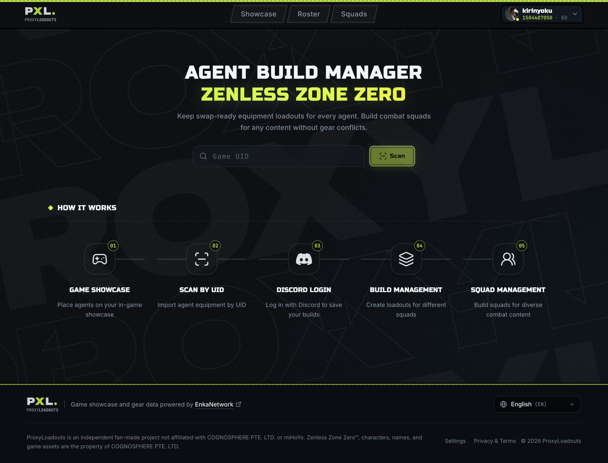
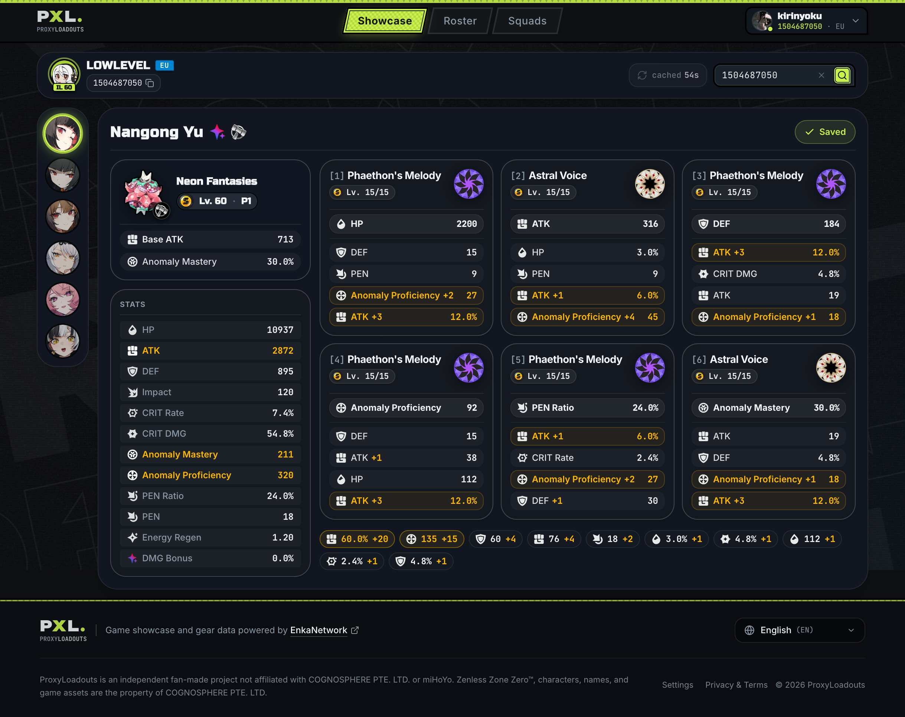
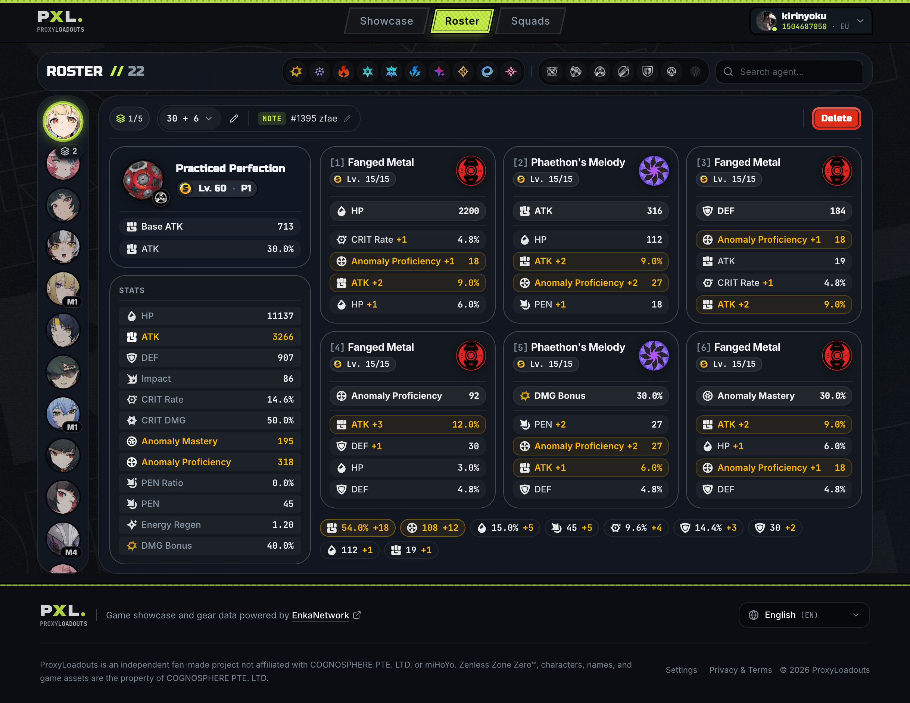
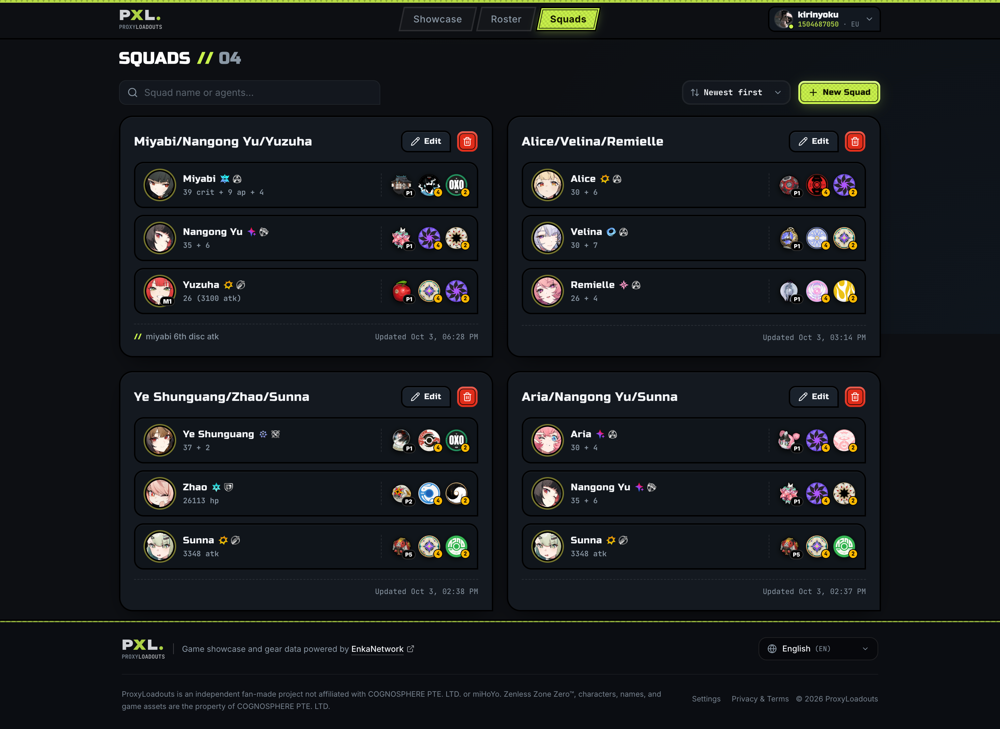
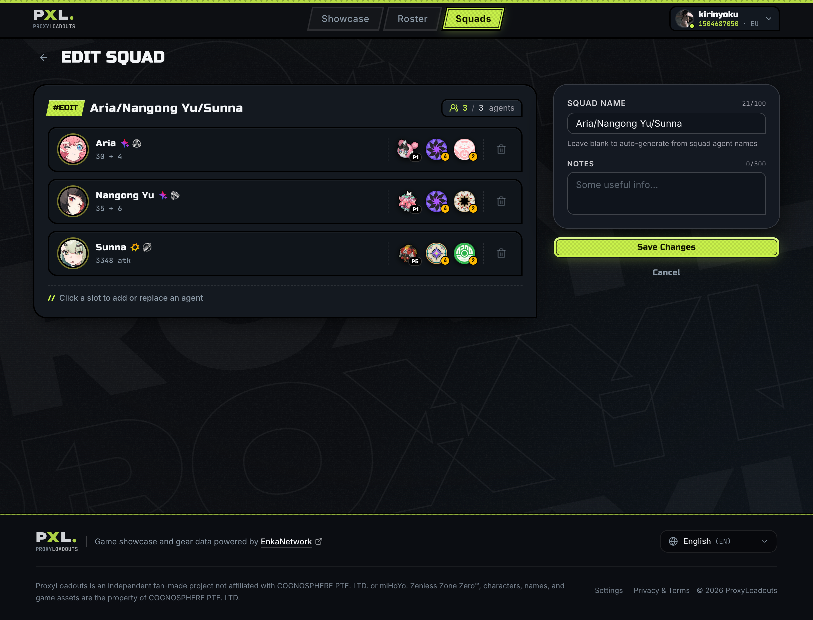
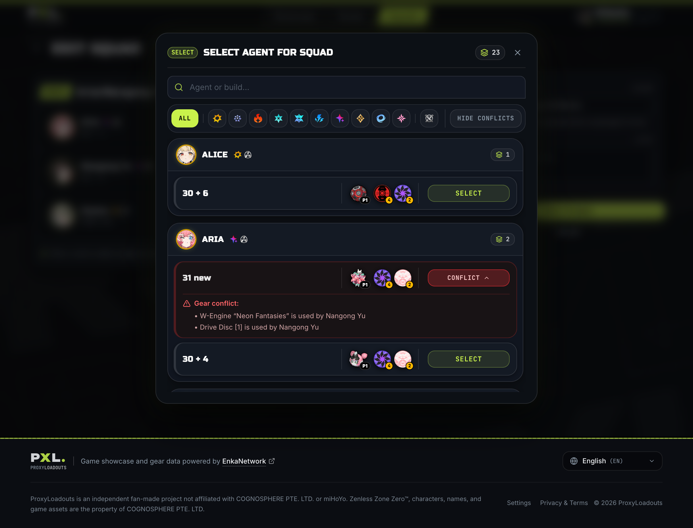
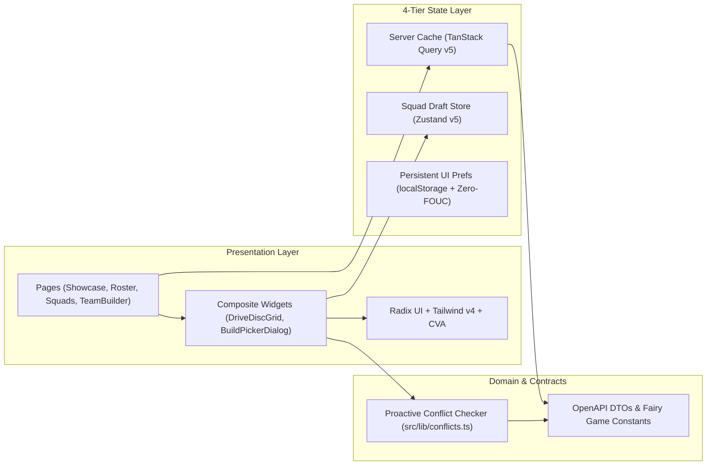

# ProxyLoadouts — Frontend UI/UX & Client Architecture

[](https://react.dev/)
[](https://www.typescriptlang.org/)
[](https://vite.dev/)
[](https://tailwindcss.com/)
[](package.json)
[](playwright.config.ts)

The frontend client of **ProxyLoadouts (PXL)** is a React 19 Single Page Application designed around a single goal: making it effortless for *Zenless Zone Zero* players to capture, organize, and reference equipment presets (W-Engines and Drive Discs) across rotating endgame bosses and combat squads.

[**Root Project Overview**](../README.md) · [**Backend Architecture**](../backend/README.md) · [**OpenAPI 3.1 Contract**](../contracts/openapi.yaml)

---

## Table of Contents

1. [UI/UX Walkthrough & Product Design Decisions](#uiux-walkthrough--product-design-decisions)
   - [1. Landing & Frictionless UID Scanning (`HomePage`)](#1-landing--frictionless-uid-scanning-homepage)
   - [2. Single-Screen Build View (`Showcase`) — Solving the "6 Screenshots" Problem](#2-single-screen-build-view-showcase--solving-the-6-screenshots-problem)
   - [3. Agent Preset Library (`Roster`) — Multiple Builds per Agent](#3-agent-preset-library-roster--multiple-builds-per-agent)
   - [4. Squad Overview (`Squads`) — Boss & Team Context at a Glance](#4-squad-overview-squads--boss--team-context-at-a-glance)
   - [5. Squad Editor & Proactive Conflict Detection (`TeamBuilder` & `BuildPickerDialog`)](#5-squad-editor--proactive-conflict-detection-teambuilder--buildpickerdialog)
2. [Design System & Visual Ergonomics](#design-system--visual-ergonomics)
3. [Frontend Architecture & State Management](#frontend-architecture--state-management)
4. [Directory Structure](#directory-structure)
5. [Development & Testing](#development--testing)

---

## UI/UX Walkthrough & Product Design Decisions

### 1. Landing & Frictionless UID Scanning (`HomePage`)



- **Scan Before Login**: Players can immediately enter their 10-digit *Zenless Zone Zero* UID on the home screen to inspect their showcase without being forced through an authentication wall first.
- **5-Step Visual Onboarding**: A concise horizontal pipeline (`Game Showcase` → `Scan by UID` → `Discord Login` → `Build Management` → `Squad Management`) explains how in-game showcase syncing translates into saved presets and squads.

---

### 2. Single-Screen Build View (`Showcase`) — Solving the "6 Screenshots" Problem



- **Why This Layout Exists**: In *Zenless Zone Zero*'s in-game menu, you cannot view the substats of all 6 equipped Drive Discs simultaneously—you must click each disc slot one by one. Saving a build with screenshots requires taking **6–7 separate screenshots**.
- **Unified Equipment Card**: ProxyLoadouts consolidates the entire build into a single scannable view:
  - **Left Column**: Equipped W-Engine (level, refinement phase `P1`–`P5`, base ATK, and secondary stat) above the agent's aggregated combat stats.
  - **Right 2×3 Grid**: All 6 Drive Disc slots (`[1]`–`[6]`) displayed side-by-side in their natural slot order, showing set icon, level, main stat, and all 4 substats.
  - **Bottom Roll Summary Bar**: Aggregates total substat upgrade rolls across all 6 discs (e.g., `60.0% +20` ATK, `135 +15` Anomaly Proficiency) to evaluate overall build quality at a glance.
- **1:1 Visual Parity & Roll Highlighting (Fast In-Game Inventory Navigation)**:
  - **The Inventory Swapping Problem**: To equip a build seen on the site, players must manually find the exact discs in their in-game inventory among dozens of candidates.
  - **1:1 In-Game Mirroring**: Disc cards replicate the in-game UI 1:1—preserving identical substat ordering, authentic highlight colors, and roll upgrade badges (`+1` through `+5`).
  - **Instant Pattern Recognition**: Players don't need to read every stat line; clicking through the in-game inventory, they can spot the target disc in seconds by visual pattern alone (e.g., recognizing that the 1st and 3rd substats have `+2` and `+3` rolls).

---

### 3. Agent Preset Library (`Roster`) — Multiple Builds per Agent



- **Why Presets Matter**: Because endgame modes (*Shiyu Defense*, *Deadly Assault*) rotate bosses and stage buffs, many agents aren't universal—they need different W-Engines, 4pc/2pc disc combinations, or Slot 4/5/6 main stats depending on the team or enemy.
- **Up to 5 Named Presets per Agent**:
  - The vertical agent rail on the left displays a stack badge (e.g., `2`) when an agent has multiple saved presets, plus Mindscape Cinema badges (`M1`–`M6`).
  - The top preset bar lets players switch between saved presets (`1/5`), give each preset a recognizable shorthand name (e.g., `30 + 6`), and attach an inline **Note** (`NOTE #1395 zfae`) to remember why that specific disc combination is used.

---

### 4. Squad Overview (`Squads`) — Boss & Team Context at a Glance



- **Compact Loadout Summary**: Each 3-agent squad card displays the chosen preset name under each agent alongside their W-Engine icon (`P1`–`P5`) and active 4pc + 2pc Drive Disc set badges.
- **Tactical Squad Notes**: Players can attach a short note to any squad (such as `// miyabi 6th disc atk`) as a reminder of boss-specific adjustments or manual disc swaps before entering combat.

---

### 5. Squad Editor & Proactive Conflict Detection (`TeamBuilder` & `BuildPickerDialog`)





- **Preventing Accidental Gear Sharing**: When two agents in the same squad rely on the same unique W-Engine or Drive Disc, you only discover the problem in-game when one agent ends up unequipped.
- **Proactive Detection in the Build Picker**: Instead of letting users assemble an invalid squad and failing on save, conflict checking happens **directly inside the `SELECT AGENT FOR SQUAD` modal** (`BuildPickerDialog`):
  - Candidate presets that share a W-Engine UID or Drive Disc UID with an agent already in the squad are marked with a red `CONFLICT` badge.
  - Expanding the conflict row lists the exact shared items (e.g., `W-Engine "Neon Fantasies" is used by Nangong Yu`, `Drive Disc [1] is used by Nangong Yu`).
  - A **`HIDE CONFLICTS`** toggle lets players filter the list down to only compatible presets.

---

## Design System & Visual Ergonomics

Defined in [`src/index.css`](src/index.css) using **Tailwind CSS v4** (`@theme inline`) and semantic CSS custom properties:

1. **Semantic Token Theming & Multi-Palette Architecture**:
   - **Data-Driven Theming**: The interface is built entirely on semantic tokens (`--background`, `--card`, `--primary`, `--border`, etc.) controlled by the `data-palette` attribute on `<html>`. Adding future themes requires only defining a new `[data-palette="..."]` block in `src/index.css` without modifying component styles.
   - **Zero-FOUC Initialization**: Active palette preference (`proxyloadouts_color_palette` in `localStorage`) is applied via a blocking inline script in `<head>` before React hydrates, dynamically adjusting `<meta name="theme-color">` for mobile browsers and PWA.
   - **Available Color Themes**:
     - **Acid Lime (Default)**: Authentic *Zenless Zone Zero* urban-tactical aesthetic with low-glare dark graphite surfaces (`#0c0f13` background, `#141920` cards) and high-contrast acid-lime neon accents (`#c9f24b`).
     - **Champagne & Bronze**: Warm, refined luxury aesthetic with warm onyx/basalt surfaces (`#0c0b0a` with a 3% brass tint), champagne gold accents (`#eab308`), and rebalanced semantic status indicators (tactical orange warning).
2. **Signature Asymmetric Corner Geometry**:
   - Cards and inputs use *Zenless Zone Zero*'s characteristic 3-rounded / 1-chamfered corner silhouette (`--radius-card: 20px 20px 0 20px`, `--radius-input: 10px 10px 0 10px`).
   - Users can switch between `rounded` (signature ZZZ asymmetric) and `sharp` corner styles in Settings, initialized synchronously in `<head>` to avoid Flash of Unstyled Content (FOUC).
3. **3-Tier Typographic Hierarchy & Tabular Figures**:
   - **Display / Headings**: `Unbounded Variable` and `Russo One` for bold urban-tactical titles.
   - **UI Body**: `Inter Variable` for readable descriptions, notes, and dialogs.
   - **Monospace & Numeric Tables**: `JetBrains Mono Variable` with `tabular-nums` so stat columns, UIDs, and substat percentages align vertically down to the pixel.
4. **Accessible Headless Primitives**:
   - Interactive dialogs, selects, tooltips, and dropdowns are built on **Radix UI Primitives** + **Class Variance Authority (`cva`)** + `tailwind-merge`, providing full keyboard navigation (`Tab`, `ArrowKeys`, `Escape`), focus trapping, and WAI-ARIA compliance.

---

## Frontend Architecture & State Management



- **Strict 4-Tier State Separation**:
  1. **Server Cache (`TanStack Query v5`)**: Owns all API fetching, caching, and mutation invalidation for showcases, builds, and squads.
  2. **Client Draft State (`Zustand v5`)**: `useTeamDraftStore` holds in-progress squad slots, name, and notes while building a new squad.
  3. **Persistent UI Preferences**: Color palette (`acid` / `champagne`), corner style (`sharp` / `rounded`), background animation toggles, and language (`EN` / `RU` via `i18next`).
  4. **Local Component State**: Ephemeral modal open states, search queries, and attribute/specialty filters.
- **Contract-First Type Safety**:
  - [`src/types/api.generated.ts`](src/types/api.generated.ts) is generated directly from [`../contracts/openapi.yaml`](../contracts/openapi.yaml) via `openapi-typescript`.
  - [`src/lib/game-constants.generated.ts`](src/lib/game-constants.generated.ts) is generated from the Go `fairy` SDK via `make codegen`, keeping agent metadata, combat attributes, specialties, and Drive Disc set definitions synchronized.

---

## Directory Structure

```text
frontend/src/
├── api/                    # Typed fetch client, ApiError parser, TanStack Query hooks
├── components/
│   ├── common/             # AppHeader, Footer, UserMenu, EmptyState, ErrorBoundary
│   ├── home/               # Landing page hero & 5-step onboarding cards
│   ├── roster/             # Preset switcher, inline build/note editor, roster sidebar
│   ├── settings/           # Linked UID management & visual preference controls
│   ├── showcase/           # W-Engine card, AgentStatsPanel, 6-slot DriveDiscGrid
│   ├── teambuilder/        # 3-slot squad editor & BuildPickerDialog with conflict checks
│   └── ui/                 # Headless Radix UI primitives (Button, Dialog, Tooltip, etc.)
├── hooks/                  # Shared React hooks (useActiveAccount, useIsMobile)
├── i18n/                   # English (EN) and Russian (RU) locale dictionaries
├── lib/                    # Client conflict checker (conflicts.ts), stat formatters, generated constants
├── pages/                  # Route views (Home, Showcase, Roster, Teams, TeamBuilder, Settings)
├── store/                  # Zustand stores (useTeamDraftStore)
├── styles/                 # Local font declarations (fonts.css)
└── types/                  # OpenAPI-generated types & domain interfaces
```

---

## Development & Testing

```bash
# Start Vite dev server with HMR (:5173, proxies /api/v1 -> :8080)
npm run dev

# Regenerate OpenAPI TypeScript types
npm run codegen:api

# Run Oxlint static analysis
npm run lint

# Run Vitest unit & component test suite
npm run test

# Typecheck and build production bundle (dist/)
npm run build

# Run Playwright E2E browser tests
npm run test:e2e
```
