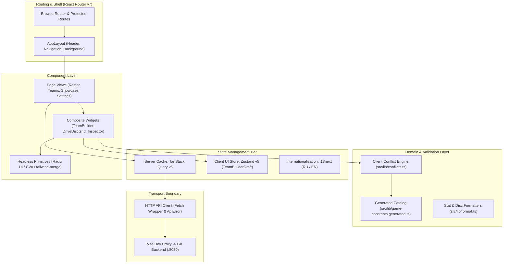

# ProxyLoadouts — Frontend Client Architecture

[](https://react.dev/)
[](https://www.typescriptlang.org/)
[](https://vite.dev/)
[](https://tailwindcss.com/)
[-729B1B?logo=vitest)](package.json)
[](playwright.config.ts)
[-blue)](.oxlintrc.json)

The frontend client for **ProxyLoadouts (PXL)** is a high-performance Single Page Application (SPA) designed for managing *Zenless Zone Zero* (ZZZ) agent builds, inspecting drive disc distributions, and assembling 3-agent combat squads with real-time conflict feedback.

---

## Table of Contents

1. [Architectural Overview & Component Topology](#architectural-overview--component-topology)
2. [Key Engineering Decisions & Trade-Offs](#key-engineering-decisions--trade-offs)
   - [Strict 4-Tier State Separation: TanStack Query & Zustand](#1-strict-4-tier-state-separation-tanstack-query--zustand)
   - [Optimistic Conflict Engine Mirroring](#2-optimistic-conflict-engine-mirroring)
   - [Accessible Headless UI Architecture (Radix Primitives)](#3-accessible-headless-ui-architecture-radix-primitives)
   - [Tailwind CSS v4 & Cyberpunk Design System](#4-tailwind-css-v4--cyberpunk-design-system)
   - [Single-Origin Topology & Zero-Secret Client Bundle](#5-single-origin-topology--zero-secret-client-bundle)
   - [Deterministic Rollup Chunk Grouping](#6-deterministic-rollup-chunk-grouping)
3. [Component & Directory Taxonomy](#component--directory-taxonomy)
4. [Contract-First API Integration & Code Generation](#contract-first-api-integration--code-generation)
5. [Development & Operational Workflows](#development--operational-workflows)
6. [Testing & Quality Verification](#testing--quality-verification)

---

## Architectural Overview & Component Topology

The client application follows unidirectional data flow, separating server cache, local UI draft state, and presentation layers.



---

## Key Engineering Decisions & Trade-Offs

### 1. Strict 4-Tier State Separation: TanStack Query & Zustand

**Decision**: Never duplicate server cache into client state variables.

- **Tier 1 (Server Cache)**: Handled exclusively by **TanStack Query v5**. Manages asynchronous lifecycles, background cache revalidation, query invalidation on mutation, and request deduplication.
- **Tier 2 (Client Draft State)**: Managed via **Zustand v5** (`useTeamBuilderStore`). Used strictly for multi-step interactive workflows, such as picking 3 agents, assigning builds to slots, and validating provisional equipment sets before committing to the database.
- **Tier 3 (Persistent Preferences)**: Local storage synchronizers for corner rounding styles (`sharp` vs `rounded`) and background animation toggles (`src/lib/corner-style.ts`, `src/lib/bg-animation.ts`).
- **Tier 4 (Ephemeral UI State)**: Scoped to React component hooks (`useState`) for modal visibility, dropdown opens, and filter inputs.

### 2. Optimistic Conflict Engine Mirroring

**Decision**: Re-implement the Go backend's conflict engine in pure TypeScript (`src/lib/conflicts.ts`).

- **The Problem**: A user picking characters, swapping builds, and reordering squad slots requires instant feedback. Relying solely on server network roundtrips causes UI lag and latency on high-frequency changes.
- **The Solution**: The client runs an identical $O(N \cdot M)$ conflict detection algorithm in memory on every slot mutation. It evaluates weapon and disc slot duplicates instantaneously ($< 1\text{ms}$).
- **Server Authority**: When saving a team, the backend executes the definitive check inside a database transaction, returning HTTP `422 Unprocessable Entity` with a structured `ConflictReport` if any invariant was breached. The client's `ApiError` parser extracts these conflicts and attaches them directly to the corresponding UI slots.

### 3. Accessible Headless UI Architecture (Radix Primitives)

**Decision**: Author UI components using headless primitives (**Radix UI**) combined with **Class Variance Authority (`cva`)** and `tailwind-merge`.

- **Accessibility (a11y)**: Interactive widgets (Dialogs, Tooltips, Selects, Dropdowns, Switches) are built on Radix UI primitives. This guarantees 100% compliance with W3C WAI-ARIA 1.2 APG standards, including focus traps inside modals, keyboard navigation (`Escape`, `ArrowKeys`, `Tab`), and screen reader status bindings (`aria-invalid`, `aria-describedby`).
- **No Wrapper Pollution**: The Slot pattern (`asChild`) allows polymorphic element delegation without introducing redundant wrapper `<div>` nodes.

### 4. Tailwind CSS v4 & Cyberpunk Design System

**Decision**: Standardize on **Tailwind CSS v4** utilizing direct `@theme` integration and CSS Custom Properties.

- **Zero-FOUC Theme Initialization**: A blocking script in `index.html` inspects `localStorage` for visual preferences (scanlines, custom corners) before DOM rendering, completely eliminating Flash of Unstyled Content (FOUC).
- **ZZZ Aesthetic Integration**: Custom keyframe animations (`zzz-dual-arc-spin`), cyberpunk grid overlays, modular type scales (Unbounded, Russo One, JetBrains Mono, Inter), and high-contrast accessibility ratios.

### 5. Single-Origin Topology & Zero-Secret Client Bundle

**Decision**: Client communicates with `/api/v1` without public environment variables or third-party client SDK credentials.

- **Development**: Vite's internal development proxy routes `/api/v1` traffic to `http://localhost:8080`.
- **Production**: The production bundle is embedded directly into the Go executable via `//go:embed` and served from the identical origin.
- **Security Implications**:
  - Eliminates Cross-Origin Resource Sharing (CORS) preflight requests in production.
  - Session cookies operate with strict `SameSite=Lax` and `Secure` attributes without subdomain cross-site exposure.
  - Zero risk of leaking OAuth secrets or server encryption keys into the public browser bundle.

### 6. Deterministic Rollup Chunk Grouping

**Decision**: Configure explicit vendor code-splitting rules in `vite.config.ts`.

- **The Problem**: Without explicit chunk grouping, modern bundlers place vendor runtimes into whichever dynamic import loads first, leading to arbitrarily named chunks (e.g. React landing inside `spinner-*.js`).
- **The Configuration**:
  ```typescript
  codeSplitting: {
    groups: [
      {
        name: 'vendor-react',
        test: /[\\/]node_modules[\\/](react|react-dom|react-router|react-router-dom|scheduler)[\\/]/,
        priority: 100,
      },
      {
        name: 'vendor-data',
        test: /[\\/]node_modules[\\/](@tanstack|i18next|react-i18next)[\\/]/,
        priority: 90,
      },
    ],
  }
  ```
- **Result**: Predictable, isolated vendor chunks that maximize browser cache reuse across releases.

---

## Component & Directory Taxonomy

```
frontend/src/
├── api/                    # API client layer
│   ├── client.ts           # Typed fetch wrapper, ApiError class, status fallbacks
│   └── hooks.ts            # TanStack Query custom hooks (useBuilds, useTeams, useShowcase)
├── components/             # Reusable UI component tree
│   ├── common/             # Global shell (AppHeader, UserMenu, ErrorBoundary, Logo)
│   ├── home/               # Landing page presentation widgets
│   ├── roster/             # Agent build management (InspectorDialog, RosterToolbar)
│   ├── settings/           # UID management forms, segmented controls
│   ├── showcase/           # Enka profile viewer (DriveDiscGrid, AgentStatsPanel)
│   ├── teambuilder/        # Squad assembly (BuildPickerDialog, TeamSlotList, Sidebar)
│   └── ui/                 # Headless Radix UI abstractions (Button, Dialog, Sonner, Tooltip)
├── hooks/                  # Cross-cutting React hooks (useIsMobile, useLocalStorage)
├── i18n/                   # Internationalization dictionaries (RU/EN) and formatters
├── lib/                    # Core utilities and client engine
│   ├── conflicts.ts        # Client-side conflict detection engine
│   ├── format.ts           # Stat value and disc property formatting
│   ├── game-constants.generated.ts # Generated constants from Go Fairy SDK
│   └── register-service-worker.ts  # Service worker lifecycle manager
├── pages/                  # Top-level route views (RosterPage, TeamsPage, ShowcasePage)
├── store/                  # Zustand global stores (teamBuilderStore, authStore)
├── styles/                 # Tailwind custom themes and typography definitions
└── types/                  # TypeScript interfaces matching OpenAPI 3.1 DTO contracts
```

---

## Contract-First API Integration & Code Generation

Client types and constants strictly mirror the backend OpenAPI 3.1 specification (`contracts/openapi.yaml`):

1. **Automated Game Constants**:
   Game elements, combat specialties, drive disc set bonuses, and asset CDN mappings are not typed manually. Running:
   ```bash
   npm run codegen
   ```
   invokes `backend/cmd/codegen`, which reflects the Go game catalog and writes `src/lib/game-constants.generated.ts`.
2. **Type Safety Guarantees**:
   Zero usage of `any`. All API responses and request payloads adhere to strict TypeScript definitions in `src/types/index.ts`.

---

## Development & Operational Workflows

### 1. Prerequisites

- **Node.js**: v22.0.0 or higher.
- **Package Manager**: `npm` (v10+).

### 2. Local Development

Start the development server with Hot Module Replacement (HMR):
```bash
npm run dev
```
The server binds to [http://localhost:5173](http://localhost:5173). Requests to `/api/v1` are automatically proxied to the backend running on port `8080`.

### 3. Production Build

To execute typechecking and compile the production bundle:
```bash
npm run build
```
This triggers:
1. `tsc -b`: Incremental TypeScript type validation across the whole project.
2. `vite build`: Rollup minification, asset content hashing, CSS purging, and chunk generation into `dist/`.

To preview the production build locally:
```bash
npm run preview
```

---

## Testing & Quality Verification

The frontend maintains a comprehensive automated testing matrix:

### 1. Unit & Integration Testing (Vitest)

Unit and component tests execute in a mocked DOM environment via **Vitest**:

```bash
# Run all unit tests
npm run test
```
*Current test suite status*: **226 tests passing across 42 test suites** in ~1.3 seconds.

### 2. Static Code Analysis (Oxlint)

Static analysis is performed using **Oxlint**, a high-performance Rust-based linter enforcing clean React, JSX, and TypeScript patterns:

```bash
npm run lint
```
*Current status*: **0 warnings, 0 errors** across 144 source files.

### 3. End-to-End User Journey Tests (Playwright)

End-to-end browser automation tests cover critical user workflows:
- `e2e/smoke.spec.ts`: Application shell bootstrapping, routing, and responsive navigation.
- `e2e/teambuilder.spec.ts`: Multi-agent squad assembly, slot assignment, and conflict warning banners.
- `e2e/teams.spec.ts`: Team list rendering, account filtering, and deletion lifecycles.

Execute the E2E test suite:
```bash
npm run test:e2e
```
